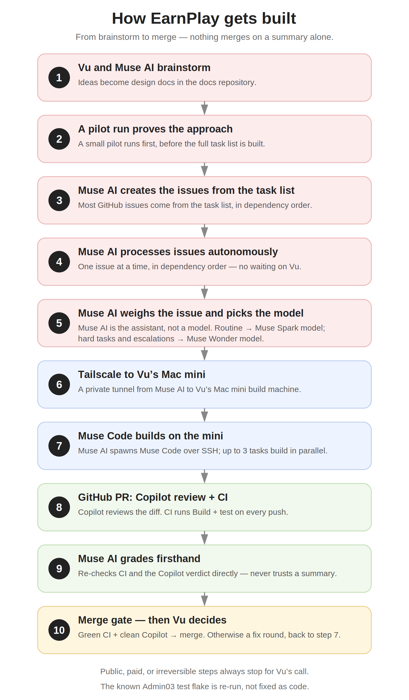

# EarnPlay

Meta Global AI Developer Hackathon entry (Oct 26 – Nov 4, 2026).
Source: the repo README at main `f13de7b` (PR #90), revised for the
submission.

## What EarnPlay is

EarnPlay is a private, on-device motivation engine and effort gate for
elementary-school children. A child takes on short math and reading
challenges — and movement and chore trades — and genuine effort, not
perfect answers, earns timed access to apps a parent has chosen.
Deterministic code holds every safety-critical decision; AI proposes,
code decides. No account, no server, and no child data ever leaves the
device.

The tutor is the challenge mechanism, not the purpose: practice is how
effort is demonstrated, and the gate is what the product is for.

## Demo video

[Watch the demo](https://www.youtube.com/shorts/WiX_nnURvZ8) — the
v7 cut of the submission video (2:56, under the 3:00 cap). The "What
was built during the event" section below matches this video frame
for frame.

## What was built during the event (Oct 26 – Nov 4, 2026)

This section lists exactly what the demo video shows — nothing more,
nothing less. Everything below was built during the event:

- **Conversational chat tutor as the child app's main screen** —
  questions, hints, probes, and answers all flow as messages; short
  math and reading challenges (Light Pink theme, two-row composer —
  the visible surface of the chat in every clip).
- **Chat-to-unlock** — tapping a locked app opens the chat tutor AS
  the challenge, so effort in the chat is what opens the app.
- **Effort-based unlock, not correctness** — wrong answers, hints,
  revisions, and explanations build effort (stars fill per question
  attempted). "Finish & check effort" grants timed access only when
  the floor is met (at least one genuine attempt AND at least one
  hint/follow-up — zero hints can never grant) and the score
  threshold is reached. An idle session opens nothing.
- **Simulated shields and Demo mode** — the simulated badge, the
  About → Demo switch, and the simulated setup catalog (see the
  Simulated shields section below).

Features that exist in the repo but are NOT shown in the video —
the admin app, session log/sync, eval harness, model spike harness,
movement/chore trades, the auditor, the child-only distribution
scheme, and the offline gate (enforcement is on-device by
architecture, but no airplane-mode demo is in the cut) — are
deliberately not listed here, so this section matches
the video frame for frame.

Earlier work lives in the docs repo (`vhoangvu/earnplay-docs`) —
brainstorm, design, and task docs from idea to implementation —
which will be made public alongside the submission:
https://github.com/vhoangvu/earnplay-docs (to be made public at
submission). One exception inside this repo itself: an Oct 22
scaffold (T0.1 — app entry-point stubs, the EarnPlayCore package
shell, the CI workflow file, `project.yml`, and the original
README) pre-dates the event. It contains no features: every feature
below — the chat tutor, chat-to-unlock, the effort engine, the
themes, simulated shields — was built during the event, and the
scaffold files themselves were substantially rewritten during it.
Nothing pre-existing is presented as event-built.
The code itself depends on no other repo (verified Nov 4: the only
Swift package is the local EarnPlayCore; the llama.cpp binary and
model weights are setup-time fetched assets, and the build works
without them). File-level authorship is stated above: only the Oct 22
scaffold pre-dates the event.

## How it was built



The loop in one picture: Vu and Muse AI brainstormed in the docs repo,
ran a pilot, and turned the task list into GitHub issues. Muse AI is the
assistant, not a model — it weighs each issue and picks the model (Muse
Spark for routine work, Muse Wonder for hard tasks and escalations).
Code runs on Vu's Mac mini over a Tailscale tunnel, up to three tasks in
parallel, through Copilot review and CI; Muse AI grades CI and the
Copilot verdict firsthand, and nothing merges without a green CI and a
clean Copilot verdict. Public, paid, or irreversible steps always stop
for Vu's call. (The diagram lives in this repo at `Docs/build-loop-diagram.png`;
it is also the closing segment of the demo video.)

## Meta models — where they run, honestly

- **Meta Llama 3.2 1B Instruct, Q4_K_M** (bartowski
  Llama-3.2-1B-Instruct-GGUF, 808 MB GGUF): first-launch download over
  Wi-Fi to Application Support, sha256-verified, then fully offline.
  Weights are fetched, never committed. The runtime (`ModelRuntime`
  over llama.cpp, CPU backend) is in the tree, and the app shows the
  required "Built with Llama" label under the Llama 3.2 Community
  License.
- **Honest state of the chat (issue #93):** in this build, the chat
  tutor runs a deterministic engine — verified question bank, solver
  check, hint ladder, canned encouragement lines — not the Llama
  model. Wiring the real model into the chat path is tracked as a
  follow-up (issue #93, after PR #92 merges) and is NOT claimed as
  done here. The demo video does not present a tutor reply as a model
  response.
- **Read-aloud is not an AI model:** it is the iOS system voice
  (`AVSpeechSynthesizer`). No AI voice is used at runtime.

## Demo honesty — simulated shields

The locks in the demo build are SIMULATED: the FamilyControls
entitlement has not been filed yet, so the shipped setup flow uses simulated
shields when the Demo flag is on (About → Demo switch + restart).
A simulated badge stays visible in the main flow while the flag is on.
The flag defaults off, so a fresh install takes the real path with no
code change. Simulated code is deleted only after real enforcement is
proven on device.

## Layout

- `EarnPlay/` — child app (chat, challenge gate)
- `EarnPlayAdmin/` — parent admin app (dashboard, policy)
- `EarnPlayCore/` — shared Swift package: deterministic logic
  (effort scoring, floor rule, unlock). Safety-critical decisions live
  here in code, never in the tutor model.
- `EarnPlayTests/` — app unit tests

Design docs and task history live in the separate earnplay-docs
repo (linked above).

## Project generation

The `.xcodeproj` is generated with
[XcodeGen](https://github.com/yonaskolb/XcodeGen) from `project.yml` —
it is not committed.

```sh
brew install xcodegen
xcodegen generate
open EarnPlay.xcodeproj
```

Schemes: `EarnPlay` (child + admin + tests), `EarnPlayAdmin`
(admin only), `EarnPlayDistribution` (child app only, for archiving
and distribution).

## Bundle IDs

The committed `project.yml` carries the maintainer's IDs. Use your own IDs
from your own Apple Developer account for any device build,
TestFlight, or App Store upload — do not sign or distribute with the
maintainer's IDs.

| Target | Bundle ID |
| --- | --- |
| EarnPlay (child app) | `com.vhoangvu.earnplay` |
| EarnPlayAdmin (admin app) | `com.vhoangvu.earnplay.admin` |
| EarnPlayTests (unit tests) | `com.vhoangvu.earnplay.tests` |

Simulator builds need no signing and work with whatever ID is in
`project.yml` — just generate and build:

```sh
xcodegen generate
xcodebuild build -scheme EarnPlay -destination 'platform=iOS Simulator,name=iPhone 16'
```

For a device build, give each app target its own ID from your own
Developer account (the test targets' IDs do not matter for
distribution). Signing is a prerequisite for archiving: sign into
Xcode with that Apple ID and let automatic signing create the
certificate and provisioning profiles — without a signing identity, a
device archive fails. Persist the team in `project.yml` so regenerating
does not wipe it: add these two lines to each app target's `settings:
base:` block (next to `PRODUCT_BUNDLE_IDENTIFIER`), with your Team ID
from your Apple Developer account (Membership details, 10 characters):

```yaml
DEVELOPMENT_TEAM: ABCDE12345
CODE_SIGN_STYLE: Automatic
```

Archive one single-app scheme at a time. Do NOT pass a single
`PRODUCT_BUNDLE_IDENTIFIER` override to `-scheme EarnPlay`: that scheme
builds both apps, so one override would stamp both with the same ID.
Archive the child app directly:

```sh
xcodegen generate
xcodebuild archive -scheme EarnPlayDistribution -allowProvisioningUpdates \
  PRODUCT_BUNDLE_IDENTIFIER=com.vhoangvu.earnplay
```

Before uploading anything, verify the built app actually carries your
ID — an upload under the wrong ID lands under the wrong app record:

```sh
/usr/libexec/PlistBuddy -c "Print CFBundleIdentifier" \
  path/to.xcarchive/Products/Applications/EarnPlay.app/Info.plist
```

One more place to keep in sync: the UI tests launch the admin app by
its literal bundle ID (`EarnPlayUITests/WalkthroughSupport.swift`,
where `adminBundleID` is defined). If you change the admin ID, update
that constant to match, or the admin UI tests will fail to launch the
app.

## Running the tests

```sh
xcodegen generate
swift test --package-path EarnPlayCore
xcodebuild test -scheme EarnPlay -destination 'platform=iOS Simulator,name=iPhone 16'
xcodebuild build -scheme EarnPlayAdmin -destination 'platform=iOS Simulator,name=iPhone 16'
```

## CI

Every push and every pull request runs GitHub Actions on a macOS
runner (`.github/workflows/ci.yml`): installs XcodeGen, generates the
project, runs `swift test` for EarnPlayCore, then `xcodebuild test`
for the EarnPlay scheme and `xcodebuild build` for the EarnPlayAdmin
scheme on an iPhone 16 simulator (signing disabled). Check the Actions
tab for results.

Deployment target: iOS 18. CI uses the macos-15 runner (Xcode 16).

## Model setup (T0.2)

`ModelRuntime` in EarnPlayCore wraps llama.cpp (pinned `b11935`, CPU
backend) and loads Meta Llama 3.2 1B Instruct Q4_K_M (808 MB GGUF)
fully offline. Model weights and the built `llama.xcframework` are
fetched, never committed:

```sh
Scripts/setup-model-spike.sh
xcodegen generate
```

Simulator staging, measured cold/warm latencies, the go/no-go on model
size, and the exact CI gap are recorded in
`Docs/ModelRuntimeSpike.md`. Without setup, the package still builds
(runtime reports unavailable) and the offline integration test skips
rather than passing vacuously.

Note: the model spike screen is a dev harness, not a shipped screen.
The shipped chat path does not call the model in this build (see
"Meta models" above and issue #93).

## Eval harness (T5.1)

Scripted end-to-end sessions for five personas (good-faith, guessing,
idling, manipulative, struggling child), scored against the LLD's fixed
pass criteria. One command, from the repo root, locally or in CI
(stub-only — no model needed):

```sh
swift run --package-path EarnPlayCore eval-harness
```

Prints a per-criterion pass/fail scorecard, writes
`EarnPlayCore/EvalHarness/eval-report-latest.json` next to the committed
baseline, and exits nonzero on any criterion failure or regression.
Details: `Docs/EvalHarness.md`.
